# 欧德曼养老院管理系统 · Oldman Care

> **让照护有记录，让家属更安心。** 一套前后端分离的养老院业务管理系统：从家属在线提交入住意向，到管理员审核、分配床位，再到护理员每天的护理 / 健康 / 用药记录、家属随时查看与发起申请，整条业务线在一个系统里闭环。


[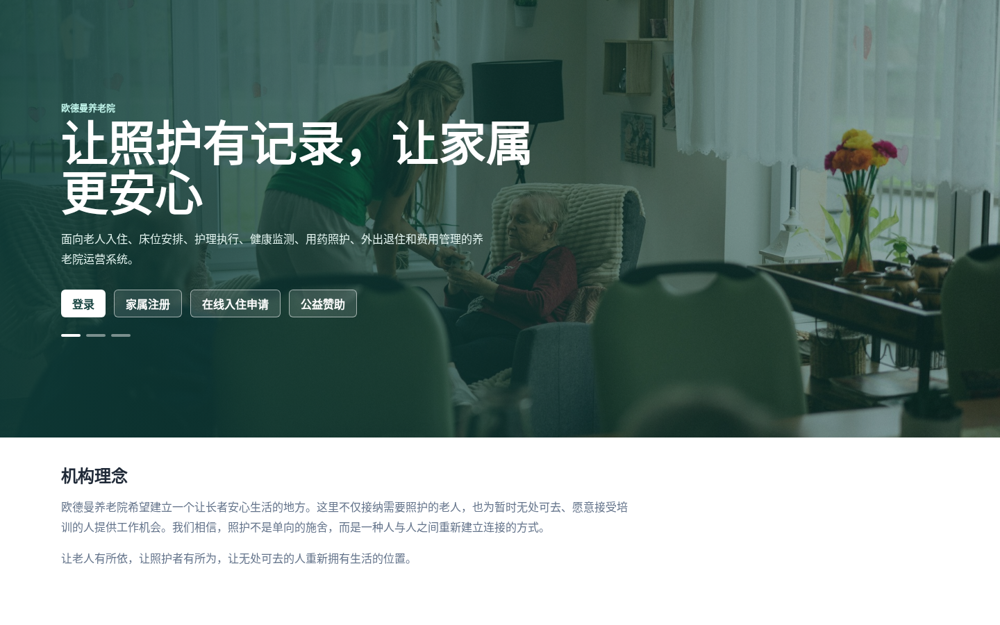](docs/screenshots/01-home.png)

<table>
  <tr>
    <td width="33%"><a href="docs/screenshots/05-admin-dashboard.png">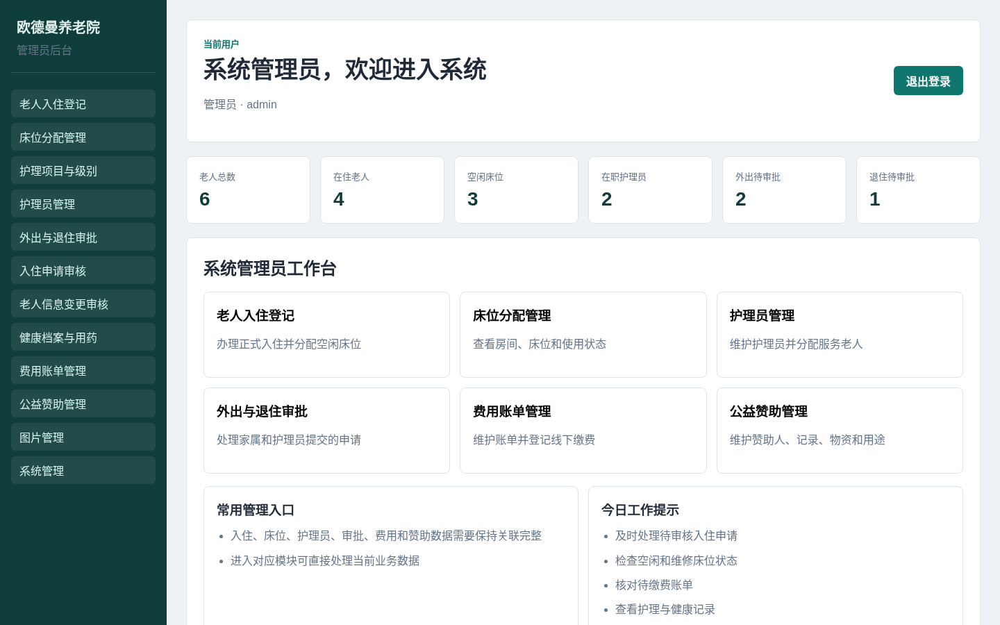</a><br><sub><b>管理员</b> · 运营看板与待办</sub></td>
    <td width="33%"><a href="docs/screenshots/15-huli-wode-laoren.png">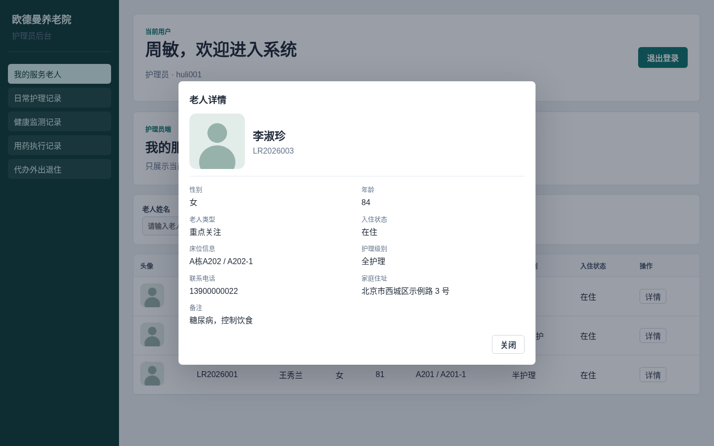</a><br><sub><b>护理员</b> · 只看到自己负责的老人</sub></td>
    <td width="33%"><a href="docs/screenshots/18-jiashu-laoren-xinxi.png">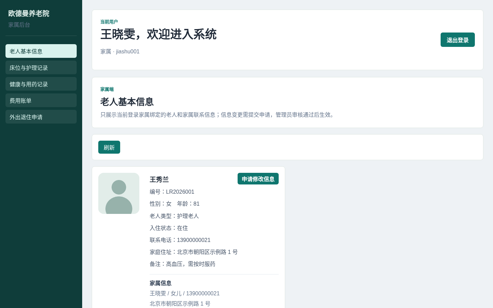</a><br><sub><b>家属</b> · 查看绑定老人并申请变更</sub></td>
  </tr>
</table>

- [亮点](#亮点) · [适用场景](#适用场景) · [功能总览](#功能总览) · [业务流程](#业务流程) · [为什么是它](#为什么是它) · [快速开始](#快速开始) · [FAQ](#faq) · [路线图](#路线图)
- [数据库说明](docs/database.md) · [外出 / 退住流程](docs/shenqing-liucheng.md) · [更新日志](CHANGELOG.md)

---

## 亮点

| | 亮点 | 说明 |
| --- | --- | --- |
| 🔁 | **完整业务闭环** | 公开入住申请 → 管理员审核 → 正式入住选床 → 护理执行 → 家属查看 / 申请 → 管理员审批，状态在老人、床位、申请之间自动联动 |
| 🛡️ | **后端按角色限定数据范围** | 不只是隐藏菜单：护理员接口只返回 `renyuan_laoren` 中“服务中”的老人，家属接口只返回手机号绑定的老人，越权请求直接被业务层拒绝 |
| 🛏️ | **入住与占床分两步** | 审核通过只建档、不占床；正式入住时才选择空闲床位，写入住登记与床位使用记录，床位变“有人”、老人变“在住” |
| 🩺 | **照护全程留痕** | 护理记录、体温 / 血压 / 心率 / 血糖 / 血氧监测、用药计划与服药执行逐条可查，家属端实时可见 |
| 💰 | **费用透明** | 按月生成床位费 + 护理费 + 药品费账单，登记线下缴费，自动计算已缴 / 未缴，家属只读 |
| 🤝 | **公益赞助公开** | 赞助人、赞助记录、物资入库、资金用途对外公示，访客可在线提交赞助意向 |
| 📦 | **开箱即跑** | 自带 `db/schema.sql` 建表脚本与虚构演示数据、环境变量配置、接口冒烟测试脚本 |

## 适用场景

- **中小型养老机构 / 日间照料中心**：替代 Excel + 微信群的入住、床位、护理和收费管理。
- **护理团队日常记录**：护理员用一个后台完成护理、健康监测、服药登记，替代纸质交接本。
- **家属远程了解老人情况**：不必每次打电话询问，护理记录、健康数据、账单一目了然；外出、退住、信息变更在线申请。
- **学习参考**：一个结构清晰的 Spring Boot + MyBatis + Vue 3 多角色业务系统样例，适合研究“按角色划分数据范围”和“状态联动”的写法。

---

## 功能总览

### 公开访客

| 首页与入口 | 在线入住申请 | 公益赞助公示 |
| --- | --- | --- |
| [](docs/screenshots/01-home.png) | [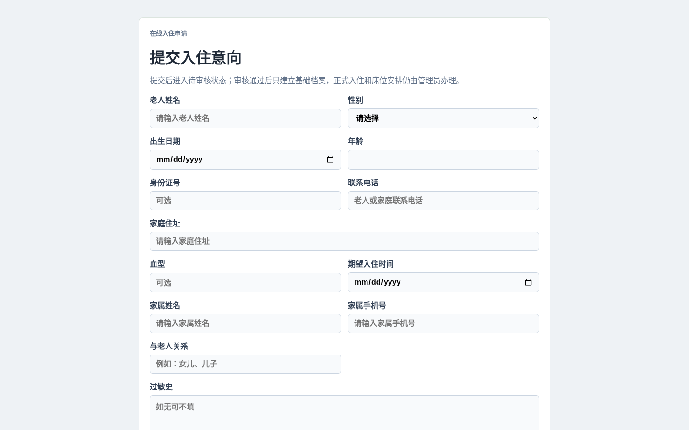](docs/screenshots/03-public-ruzhu-shenqing.png) | [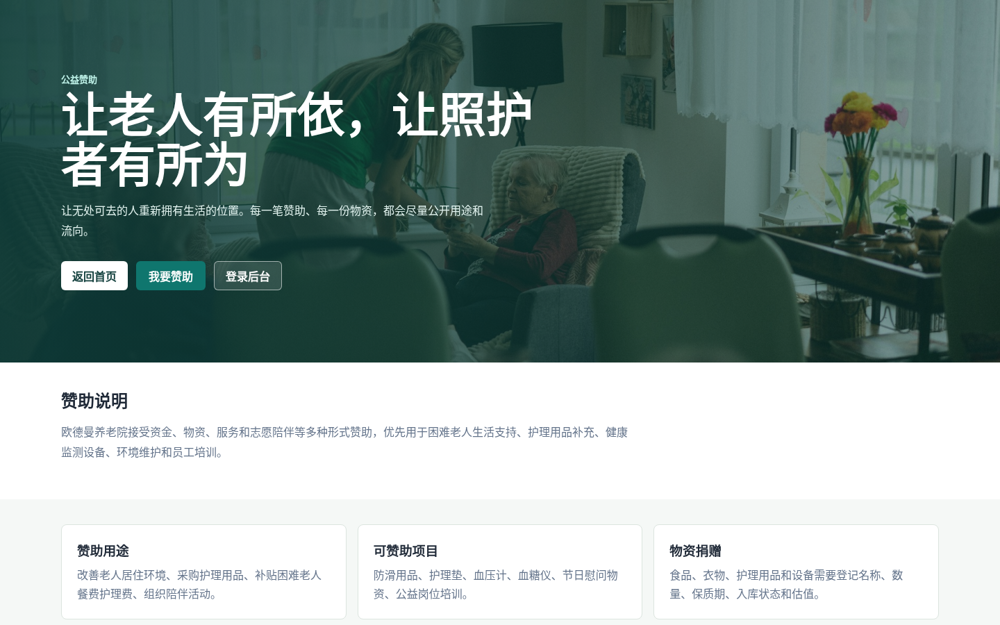](docs/screenshots/04-public-zanzhu.png) |

- 对外首页：机构理念、环境图片轮播、入口按钮。
- 家属注册：注册后自动按手机号与老人家属信息绑定。
- 在线入住意向：填写老人与家属资料、健康情况、护理需求，提交后进入管理员审核队列。
- 公益赞助：公开展示赞助记录、物资和资金用途，可提交赞助意向。
- 统一登录：滑块验证后按角色跳转到对应后台。

[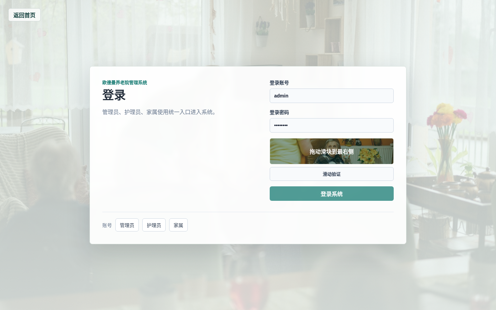](docs/screenshots/02-login.png)

### 管理员

| 入住申请审核 | 正式入住登记 | 床位分配 |
| --- | --- | --- |
| [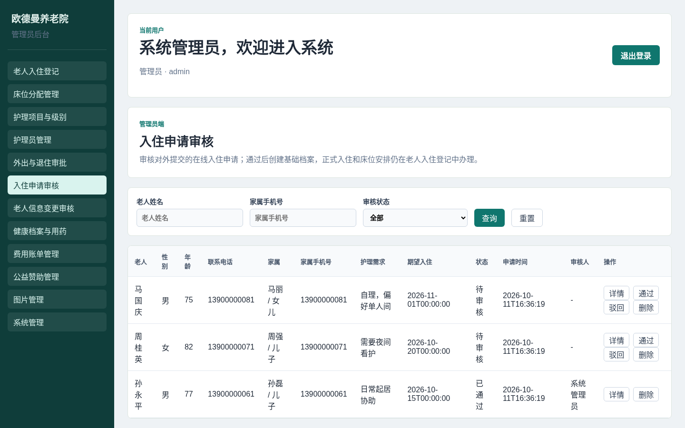](docs/screenshots/06-admin-ruzhu-shenqing.png) | [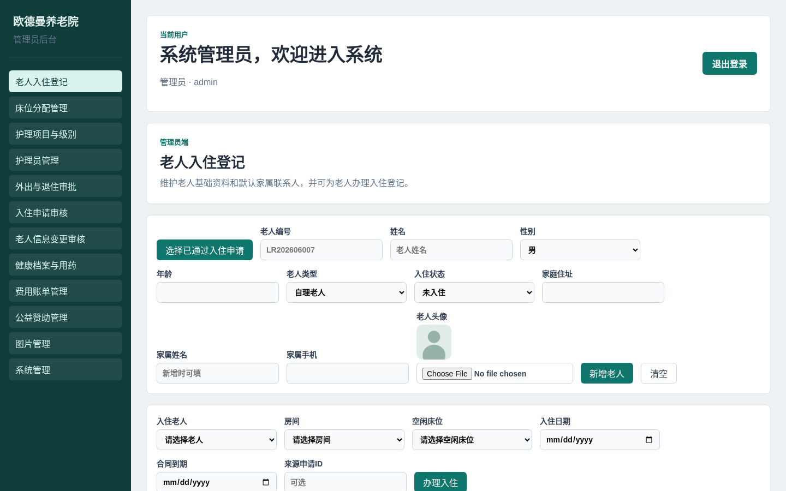](docs/screenshots/07-admin-ruzhu-dengji.png) | [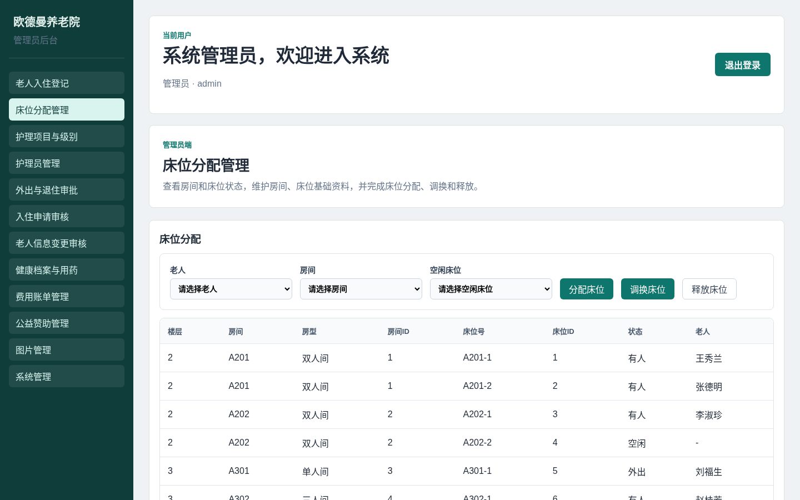](docs/screenshots/08-admin-chuangwei.png) |
| **护理项目与级别** | **外出与退住审批** | **费用账单** |
| [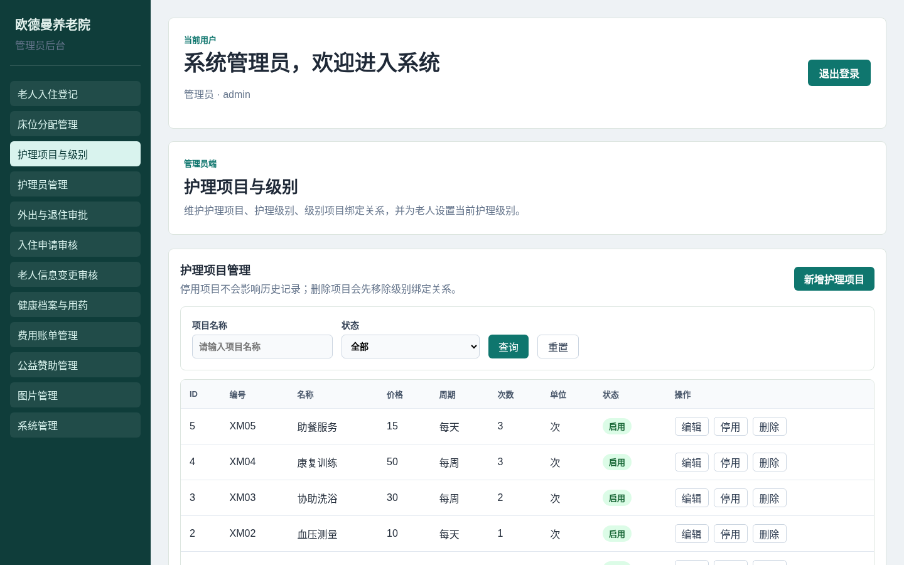](docs/screenshots/09-admin-huli-xiangmu.png) | [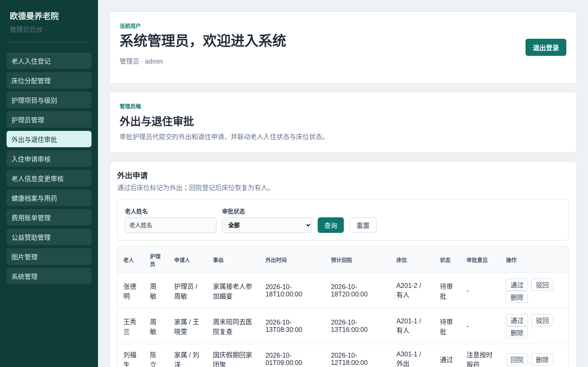](docs/screenshots/10-admin-shenpi.png) | [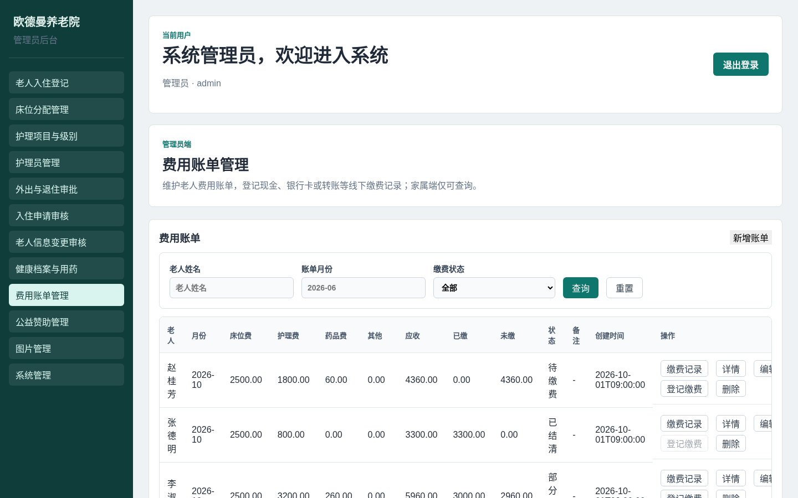](docs/screenshots/11-admin-feiyong.png) |
| **公益赞助管理** | **系统管理** | **工作台** |
| [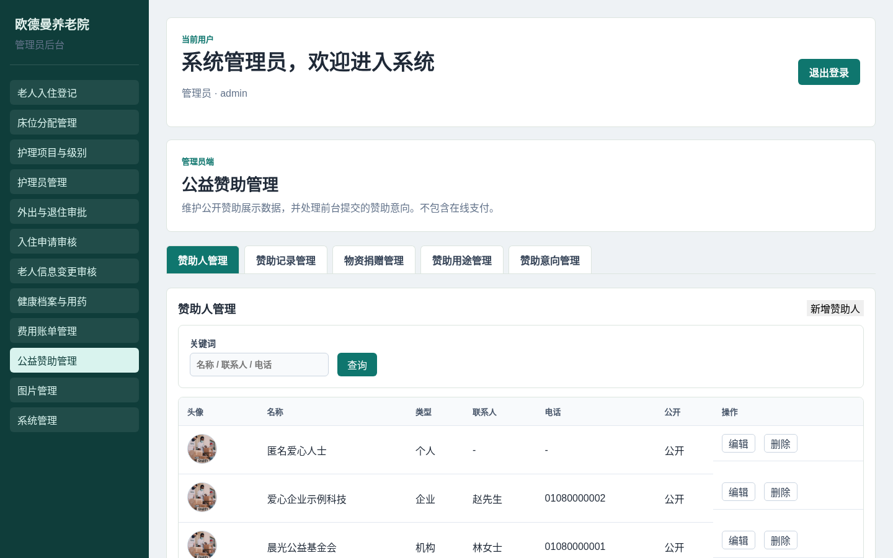](docs/screenshots/12-admin-zanzhu.png) | [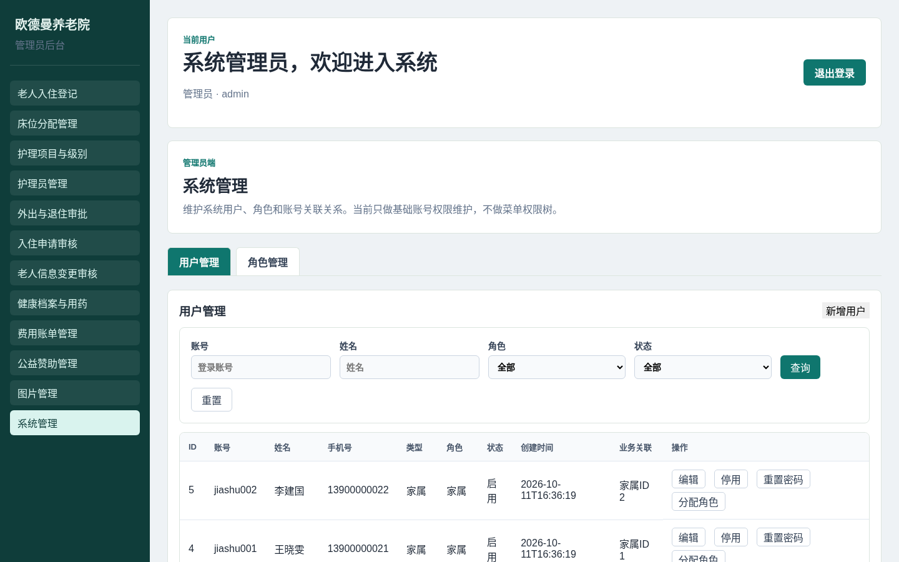](docs/screenshots/13-admin-xitong.png) | [](docs/screenshots/05-admin-dashboard.png) |

| 模块 | 能做什么 |
| --- | --- |
| 工作台 | 老人总数、在住人数、空闲床位、在职护理员、待审批外出 / 退住数量 |
| 入住申请审核 | 审核公开提交的入住意向，通过后自动建立老人档案与家属信息（不占床） |
| 入住登记 | 从已通过申请带入资料，选择空闲床位办理入住，记录合同到期与押金 |
| 床位分配 | 房间、床位维护，分配 / 调换 / 释放床位，床位状态（空闲 / 有人 / 外出）联动 |
| 护理员管理 | 维护护理员档案，把老人分配给护理员，防止重复分配 |
| 护理项目与级别 | 定义护理项目和护理级别（级别包含哪些项目、月费用），为老人设置护理级别 |
| 外出 / 退住审批 | 审批家属或护理员提交的申请；外出通过后床位标记外出，回院登记恢复；退住通过后释放床位 |
| 老人信息变更审核 | 家属提交的电话、住址、头像、备注变更，审核通过后才写回正式档案 |
| 健康档案与用药 | 查看全院护理记录、健康监测、服药执行，维护药品和用药计划 |
| 费用账单 | 生成月度账单、登记线下缴费，自动计算已缴 / 未缴与账单状态 |
| 公益赞助 | 赞助人、赞助记录、物资捐赠、资金用途、赞助意向的全流程维护与公开控制 |
| 图片管理 | 统一管理首页轮播、环境图、默认图、头像等上传资源 |
| 系统管理 | 用户、角色、重置密码、启停账号 |

### 护理员

| 工作台 | 老人详情 | 健康监测 | 用药执行 |
| --- | --- | --- | --- |
| [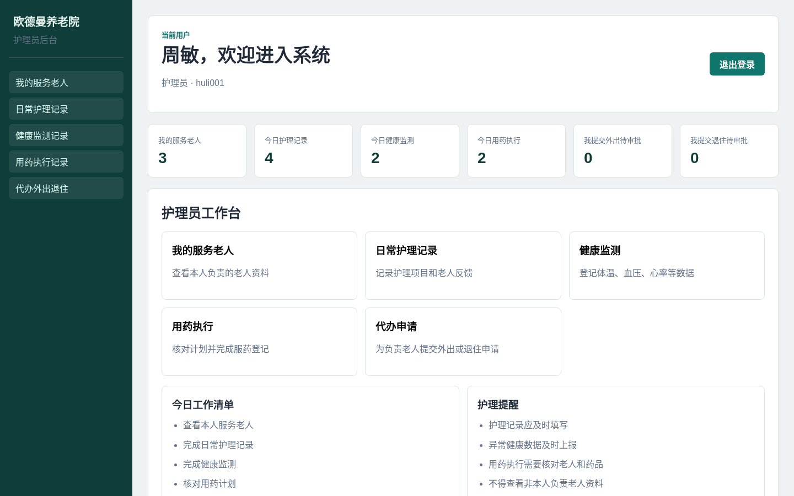](docs/screenshots/14-huli-dashboard.png) | [](docs/screenshots/15-huli-wode-laoren.png) | [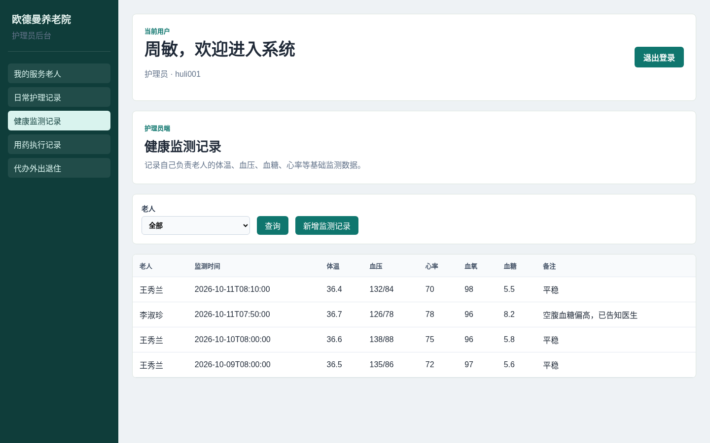](docs/screenshots/16-huli-jiankang-jiance.png) | [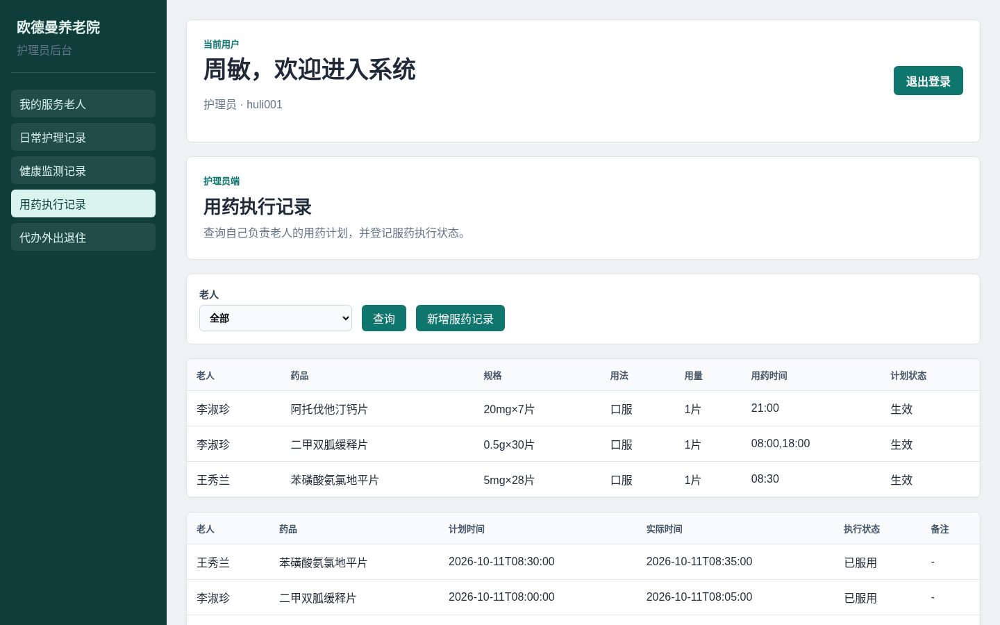](docs/screenshots/17-huli-fuyao-jilu.png) |

- **我的服务老人**：只显示管理员分配给自己的老人，含床位、护理级别和详情。
- **日常护理记录**：只能选择老人当前护理级别包含的项目，记录内容与老人反馈。
- **健康监测**：体温、血压、心率、血氧、血糖与情况说明。
- **用药执行**：按用药计划登记实际服药时间和执行状态。
- **代办外出 / 退住**：替老人提交申请，交给管理员审批。

### 家属

| 老人基本信息 | 床位与护理记录 | 费用账单 |
| --- | --- | --- |
| [](docs/screenshots/18-jiashu-laoren-xinxi.png) | [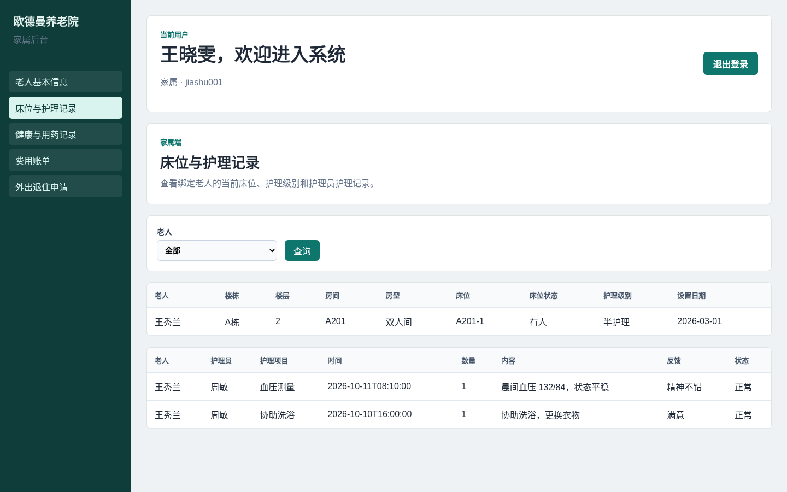](docs/screenshots/19-jiashu-huli-jilu.png) | [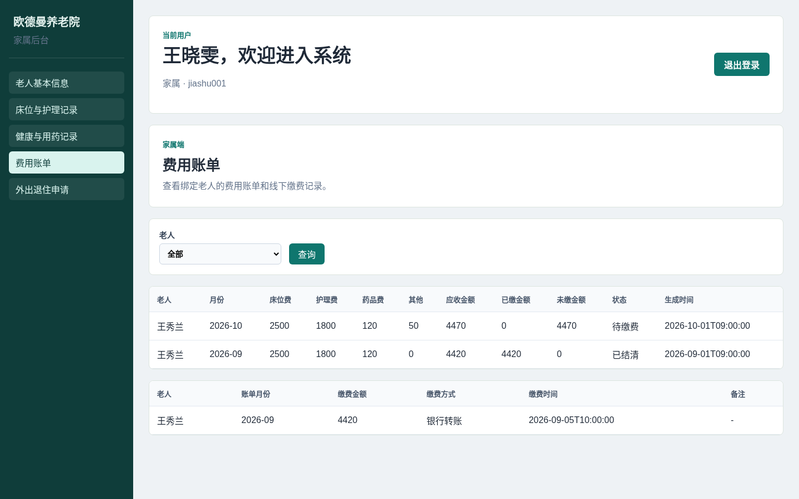](docs/screenshots/20-jiashu-feiyong.png) |

- 查看绑定老人的档案、床位、护理级别、护理记录、健康数据、用药计划和服药情况。
- 查看月度账单与缴费记录（只读）。
- 提交外出、退住申请和老人信息变更申请，跟踪审批结果。

> 以上截图均为本地实际运行 `db/seed.sql` 演示数据后的真实页面，人物与数据均为虚构。

---

## 业务流程

```text
入住   访客提交入住意向 ──▶ 管理员审核（建档、绑定家属，不占床）
                         ──▶ 正式入住：选空闲床位 ──▶ 入住登记 + 床位使用记录
                                                 ──▶ 床位「有人」，老人「在住」

护理   管理员分配护理员、设置护理级别
       ──▶ 护理员在服务范围内记录护理 / 健康监测 / 服药
       ──▶ 管理员全院监管，家属实时查看

申请   家属或护理员提交外出 / 退住 / 信息变更
       ──▶ 管理员审批
           外出通过：老人「外出」、床位「外出」 ──▶ 回院登记后恢复
           退住通过：老人「退住」、结束床位使用、床位「空闲」
           信息变更通过：写回正式老人档案

费用   管理员按月生成账单 ──▶ 登记线下缴费 ──▶ 自动结算状态 ──▶ 家属查看
```

更细的外出 / 退住设计见 [`docs/shenqing-liucheng.md`](docs/shenqing-liucheng.md)。

## 为什么是它

| 对比 | Excel / 纸质台账 + 微信群 | 通用 OA / 表单工具 | 欧德曼养老院管理系统 |
| --- | --- | --- | --- |
| 床位状态 | 手工维护，容易与实际不符 | 需要自行搭建 | 入住、外出、退住自动联动 |
| 数据隔离 | 文件谁拿到谁能看 | 多按表单权限 | 后端按“护理员负责的老人 / 家属绑定的老人”限定 |
| 护理留痕 | 交接本，难以检索 | 可做但字段需自建 | 护理项目受护理级别约束，记录可按老人检索 |
| 家属知情 | 依赖电话、群消息 | 一般不面向家属 | 家属有独立后台，可查看可申请 |
| 档案修改 | 直接改表 | 视配置 | 家属只能提交变更申请，管理员审核后生效 |
| 部署成本 | 无 | 订阅 / 自建 | 一个 Spring Boot jar + 一个静态前端 + MySQL |

---

## 系统架构

```text
浏览器
  └─ oldman1  前端（Vue 3 + Vue Router + Axios，Vite 开发端口 8090）
        │  /api/*（去前缀转发）  /uploads/*
        ▼
     oldman01  后端（Spring Boot 4 + MyBatis，端口 8081）
        ├─ Controller → Biz（角色与数据范围校验）→ Mapper XML
        ├─ MySQL 8 / MariaDB（库名 oldman，31 张表 + 2 个视图）
        └─ uploads/  图片与上传文件（/uploads/** 静态映射）
```

| 层级 | 技术 |
| --- | --- |
| 后端 | Spring Boot 4.0.6、MyBatis（XML Mapper）、HikariCP、MySQL Connector/J |
| 语言 | Java 25 |
| 前端 | Vue 3.5、Vue Router 4、Axios、Vite 7 |
| 数据库 | MySQL 8.x / MariaDB 10.6+（utf8mb4） |
| 鉴权 | 自定义 Token（`oldman-{用户ID}-{时间戳}`），业务层按角色校验 |

后端按业务分包：`gongkai`（公开端）、`denglu`（登录）、`admin`、`chuangwei`、`huliguanli`、`huliyuan`、`jiashu`、`laoren`、`health`、`yaopin`、`zanzhu`、`wenjian`、`xitong`、`kanban` 等。

---

## 快速开始

### 环境

| 项 | 版本 |
| --- | --- |
| JDK | 25（`oldman01/pom.xml` 中 `java.version`） |
| Maven | 3.9+ |
| Node.js | `^20.19.0` 或 `>=22.12.0`（Vite 7 要求） |
| 数据库 | MySQL 8.x 或 MariaDB 10.6+ |

### 1. 初始化数据库

```bash
mysql -u root -p -e "CREATE DATABASE IF NOT EXISTS oldman DEFAULT CHARACTER SET utf8mb4 COLLATE utf8mb4_general_ci"
mysql -u root -p oldman < db/schema.sql   # 表结构 + 视图
mysql -u root -p oldman < db/seed.sql     # 演示数据（可选）
```

### 2. 启动后端

```bash
cd oldman01
export OLDMAN_DB_USER=root            # 或单独创建的数据库账号
export OLDMAN_DB_PASSWORD='你的密码'
mvn spring-boot:run
# 或：mvn -DskipTests package && java -jar target/oldman01-0.0.1-SNAPSHOT.jar
```

Windows PowerShell 用 `$env:OLDMAN_DB_PASSWORD='你的密码'`。检查：`http://localhost:8081/hello`、`http://localhost:8081/db/ping`。

### 3. 启动前端

```bash
cd oldman1
npm install
npm run dev
```

打开 `http://localhost:8090`。

### 4. 登录体验

| 角色 | 账号 | 密码 |
| --- | --- | --- |
| 管理员 | `admin` | `admin123` |
| 护理员 | `huli001` / `huli002` | `123456` |
| 家属 | `jiashu001` / `jiashu002` | `123456` |

登录页右下角的“管理员 / 护理员 / 家属”按钮可一键填入账号。演示账号仅用于本地体验，部署前请修改或删除。

### 5. 冒烟测试（可选）

```bash
python3 scripts/smoke_test.py
# admin      通过  47，角色隔离拦截  22
# huli001    通过  15，角色隔离拦截  54
# jiashu001  通过  17，角色隔离拦截  52
# 全部通过（69 个 GET 接口 × 3 个角色）
```

### 配置项

| 环境变量 | 默认值 | 说明 |
| --- | --- | --- |
| `OLDMAN_DB_URL` | `jdbc:mysql://127.0.0.1:3306/oldman?...` | JDBC 连接串 |
| `OLDMAN_DB_USER` | `root` | 数据库用户 |
| `OLDMAN_DB_PASSWORD` | `your_password_here` | 数据库密码 |
| `OLDMAN_UPLOAD_DIR` | 仓库根目录 `uploads/` | 上传文件目录 |

### 生产构建

```bash
cd oldman1 && npm run build      # 产物在 oldman1/dist，可由 Nginx 托管，/api 反向代理到 8081 并去掉前缀
cd oldman01 && mvn -DskipTests package
```

---

## 目录结构

```text
oldman/
├── oldman01/                后端（Spring Boot）
│   └── src/main/
│       ├── java/com/neu/    按业务分包：controller / biz / mapper / entity
│       └── resources/       application.properties、mapper/*.xml
├── oldman1/                 前端（Vue 3 + Vite）
│   └── src/                 views/{duiwai,denglu,admin,huliyuan,jiashu} 等
├── db/
│   ├── schema.sql           建表脚本（31 张表 + 2 个视图）
│   └── seed.sql             虚构演示数据
├── scripts/smoke_test.py    接口冒烟测试
├── uploads/                 默认图片与上传文件
└── docs/
    ├── database.md          数据库与表关联说明
    ├── shenqing-liucheng.md 外出 / 退住流程设计
    └── screenshots/         运行截图
```

`oldman01` / `oldman1` 是历史目录名，分别对应后端 / 前端。

---

## FAQ

<details>
<summary><b>家属登录后看不到老人？</b></summary>

家属账号通过 **手机号** 与 `jiashu_xinxi.shouji` 绑定。请确认注册手机号与入住申请 / 家属信息里填写的一致；管理员也可以在“系统管理”中查看和调整。
</details>

<details>
<summary><b>护理员提示“只能操作自己负责的老人”？</b></summary>

由管理员在“护理员管理”中把老人分配给该护理员（状态“服务中”）。护理记录只能选择老人当前护理级别包含的项目，需要先在“护理项目与级别”中为老人设置护理级别。
</details>

<details>
<summary><b>启动报 <code>Access denied</code> / <code>Unknown database 'oldman'</code>？</b></summary>

检查 `OLDMAN_DB_USER` / `OLDMAN_DB_PASSWORD` 是否正确，并确认已执行 `CREATE DATABASE` 和导入 `db/schema.sql`。更多排错见 [`docs/database.md`](docs/database.md#7-常见问题)。
</details>

<details>
<summary><b>公开赞助页报错？</b></summary>

公开赞助数据来自视图 `v_zanzhu_gongkai`、`v_zanzhu_yongtu_gongkai`，它们包含在 `db/schema.sql` 末尾，请确认已完整导入。
</details>

<details>
<summary><b>图片显示不出来？</b></summary>

后端默认把仓库根目录的 `uploads/` 映射到 `/uploads/**`。如果从其他工作目录启动，请设置 `OLDMAN_UPLOAD_DIR` 指向该目录。
</details>

<details>
<summary><b>能直接用于真实机构吗？</b></summary>

可以作为起点，但上线前至少需要完成“路线图”中的安全项：密码哈希、带过期的 Token、HTTPS 部署，并替换演示账号。
</details>

---

## 已知限制

1. 密码以明文存储，Token 为简化实现（`oldman-用户ID-时间戳`），无过期 / 吊销机制，未使用 Spring Security。
2. 家属与登录用户通过手机号关联，手机号不一致会导致无法绑定。
3. 费用为线下登记，不含在线支付。
4. 角色本身的启停 / 删除能力较弱，主要通过用户启停控制。
5. 暂无自动化单元测试，接口层用 `scripts/smoke_test.py` 做冒烟检查。

## 路线图

- [x] 多角色业务闭环：入住、床位、护理、健康用药、审批、费用、公益赞助
- [x] 后端按角色限定数据范围
- [x] 可直接导入的建表脚本与演示数据
- [x] 环境变量配置数据库连接
- [x] 接口冒烟测试脚本
- [ ] 密码哈希存储（BCrypt）与带过期时间的 Token
- [ ] 统计报表：入住率、护理工作量、月度收支
- [ ] 账单到期 / 合同到期 / 用药提醒
- [ ] 后端单元测试与 GitHub Actions 持续集成
- [ ] Docker Compose 一键启动
- [ ] 移动端适配（护理员手机录入）

---

## 文档

| 文档 | 说明 |
| --- | --- |
| [`docs/database.md`](docs/database.md) | 建库、演示账号、表关联、排错 |
| [`docs/shenqing-liucheng.md`](docs/shenqing-liucheng.md) | 外出 / 退住申请与审批流程 |
| [`oldman01/README.md`](oldman01/README.md) · [`oldman1/README.md`](oldman1/README.md) | 后端 / 前端模块说明 |
| [`CHANGELOG.md`](CHANGELOG.md) | 更新日志 |

## 说明

- 仓库中的演示数据（人物、电话、地址、身份证号）均为虚构。
- 数据库密码请通过环境变量提供，不要提交到仓库。
- 本仓库目前未附带开源许可证（LICENSE）。
